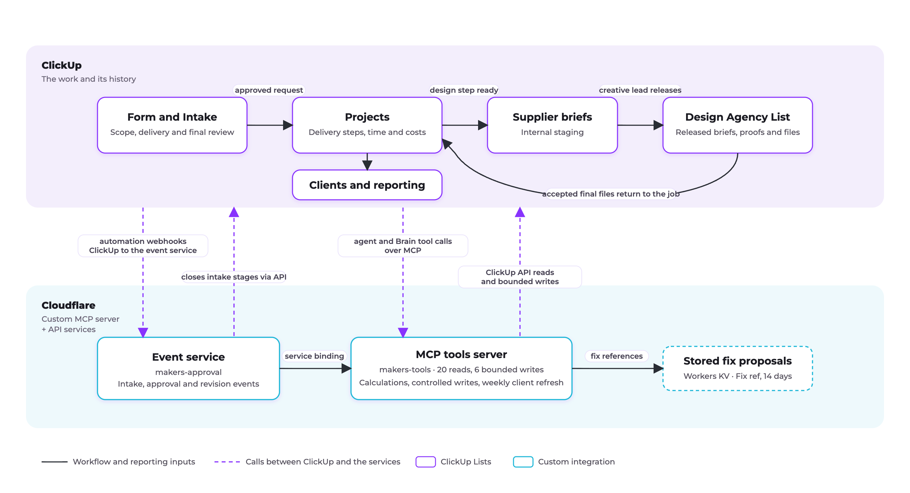

# Makers tools

A ClickUp intake, delivery and reporting system with a custom MCP server and supporting services, designed by Martin Johnson. Deployed on Cloudflare Workers: 26 tools (20 reads, 6 bounded writes), two services, 148 automated tests.

Configured for Makers Marketing Co., the system connects client requests and agreed scope to delivery plans, team capacity, project costs and management reporting.

ClickUp holds the work and its history. Custom services calculate schedules and business figures and write back within set limits. AI agents assess requests, prepare handovers and explain results. Account and delivery leads own commercial commitments and delivery decisions.

This repository contains the source code, automated tests, ClickUp configuration records, agent instructions and operating guidance for evaluating, maintaining and extending the system.

## Workflow and architecture



[Diagram source (SVG)](docs/architecture.svg)

The workflow runs through ClickUp’s records, review stages and delivery steps. Two Cloudflare Workers provide the custom calculations, bounded writes and scheduled client refresh.

Solid arrows show the workflow and reporting inputs. Dashed arrows show calls between ClickUp and the services. The event service calls shared write functions on the tools server and closes intake stages through the ClickUp API.

Implementation: [automation rules](docs/rules.md), [agent configuration](agents/README.md), [service entrypoints](tools-server/worker.js), [event handling](event-service/worker.js), [weekly refresh](tools-server/jobs.js).

## Design decisions

| Decision | Reasoning |
|---|---|
| Move the approved request into Projects as the same task. | The brief, discussion, attachments and delivery steps remain with the work through handover. [Rules](docs/rules.md#intake) |
| Record the committed date and initial cost forecast at approval. | Later delivery and cost figures can be compared with the recorded starting point. [Fields and definitions](docs/glossary.md) |
| Use delivery steps with owners, estimates and logged time. | The same underlying work records support capacity planning, cost calculations and reporting by step. [Workspace records](docs/workspace.md), [calculations](docs/tools.md) |
| Calculate schedules and reporting figures in code; use agents for assessment, summaries and explanation. | Calculations can be tested and reused while agents interpret the request and communicate the result. [Scheduling](docs/scheduling.md), [agents](agents/README.md) |
| Share integration write functions between the tools server and event service. | Client linking, baseline capture and step-field updates use one implementation. [Service binding](tools-server/worker.js#L36) |
| Bind recovery approval to a stored proposal and its Fix ref. | Approval identifies exact task IDs and date changes, which are checked against current records before writing. [Stored proposals](tools-server/fixes.js), [Apply fix](tools-server/writes.js#L364) |
| Prepare supplier briefs in internal staging before release. | Draft content and attachments receive a creative-lead review before entering the supplier’s shared List. [Brief instructions](agents/design-brief-writer/instructions.txt) |
| Return figures with their calculation basis, timestamp and source references. | A reported result can be traced to the records and calculations behind it. [Result format](docs/tools.md#what-every-result-holds) |

## One request through the system

A new fixed-fee launch request, step by step.

| Step | Owner | Decision | Evidence | Resulting action |
|---|---|---|---|---|
| **1. Request arrives** | Requester; account lead receives the request | Identify the requested work, agreement type and requested date. | Form answers, supplied materials and Client record. | The Form creates an Intake task. Rules apply the launch steps and review stages; the linking service connects a uniquely matched Client record and fills empty ownership fields. |
| **2. Scope review** | Account lead, supported by the Intake Advisor | Is the work covered, and are the required inputs available? | Agreement or accepted quote, inputs checklist, attachments and the Advisor’s assessment. | Gaps are returned for clarification. Once checked, commercial fields and leads are recorded and the request moves to Delivery review. |
| **3. Delivery review** | Delivery lead, supported by the Delivery Planner | Do the steps, estimates, capacity and proposed date fit the request? | Step estimates, existing bookings, supplier turnaround, calculated plan and Workload view. | The server calculates and writes the first plan. The delivery lead checks it before moving the request to Final review. |
| **4. Approval and handover** | Account lead; delivery lead receives the job | Are scope, date and commercial terms agreed? | Agreement, requested and feasible dates, forecast cost and budget. | Approval moves the same task into Projects, records the baseline, copies shared fields to its steps and starts the Handover Writer. |
| **5. Delivery begins** | Delivery lead and assigned step owners | Is the job ready to start, and does each completed step meet its review requirements? | Handover summary, source brief, step instructions, checklists and produced work. | Team-owned steps receive named owners. Work and time are recorded on the steps; completion releases dependent steps as Ready. |
| **6. Supplier work** | Creative lead and Design Agency | Is the brief ready for release, and are the proof and final files acceptable? | Approved copy, deliverables, source materials, deadline, rounds and submitted files. | The Design Brief Writer drafts in staging. The creative lead checks and releases the brief, reviews the outputs, and returns accepted files to the internal Design step. |
| **7. Recovery, when proposed** | Delivery lead or workspace owner | Approve the proposed date changes or leave them unapplied. | Forecast, listed moves, Fix ref and current step dates. | An authorised “apply” reply permits the server to write the stored moves after its checks. The server rechecks Health and the Planner posts the confirmation. |
| **8. Delivery and acceptance** | Studio and account lead | Are the files ready to send, and has written client acceptance been received? | Accepted design files, packaged outputs, internal review and the acceptance recorded on Deliver. | Sending records Delivered on. Written acceptance closes Deliver; completion rules close the project and record Accepted on. |
| **9. Reporting** | Account lead and leadership | Which delivery, cost or rework findings warrant attention? | Recorded dates, approval baseline, logged hours, rates, fees, supplier costs and rework tags. | The Monday refresh updates Client figures and Account health. Monthly review returns the measures with their source calculations for review. |

The [rules](docs/rules.md), [agent records](agents/README.md), [scheduling reference](docs/scheduling.md) and [tool reference](docs/tools.md) document the automated actions and calculations.

## Ownership and boundaries

| Area | Owner | Responsibility |
|---|---|---|
| Services | IT | Maintain the two Workers, credentials, stored fix proposals, schedules and logs; test changes, record deployments and manage rollback. [Operating instructions](#operating-instructions), [deployment record](DEPLOYMENTS.md). |
| Workspace configuration | Workspace owner | Maintain Lists, statuses, Custom Fields, templates, Teams, automation rules, access and the Makers tools connection. [Workspace configuration](docs/workspace.md), [rules](docs/rules.md). |
| Agent instructions | Workspace owner; IT for settings shared with the code | Maintain Instructions, Skills, triggers, tools and knowledge in ClickUp, with their text recorded in this repository. Editing a repository file does not update an agent in ClickUp. [Agent configuration](agents/README.md). |
| Business thresholds | Workspace owner for process changes; IT for code settings | Maintain capacity, planning allowances, project Health and Account health settings. Where a value also appears in a Skill, update both together. [Scheduling settings](docs/scheduling.md#settings), [tool settings](docs/tools.md#settings-in-the-code), [Account health](tools-server/jobs.js). |
| Supplier access | Workspace owner for permissions; creative lead for release | Keep the Design Agency guest's access scoped to the Design Agency List. Staging and internal project records remain internal; the creative lead checks the brief and attachments before release. [Workspace records](docs/workspace.md), [brief instructions](agents/design-brief-writer/instructions.txt). |

ClickUp permissions control supplier access. The Design Brief Writer's instructions exclude price, budget, rate, hours and commercial terms from its output; the creative lead reviews the material released to the supplier.

## Status and evidence

| | |
|---|---|
| Snapshot | 13 November 2026. |
| Deployment | Mirrors `makers-tools` version `e05f8f85`, deployed on 13 November 2026. The event-service code is unchanged since 5 November 2026; agent text was read from ClickUp on 13 November 2026. |
| Recorded checks | 148 automated tests complete successfully, including four marked `expectFailure` for known scheduling limits. Both Workers build with a dry run. Live checks cover authentication, tool discovery and approval of a stored fix. [Verification record](#status-of-this-snapshot), [tests and known limits](#tests). |
| Release history | [DEPLOYMENTS.md](DEPLOYMENTS.md) is the template for deployments made from this repository. |
| Context | Makers Marketing Co. and its records are a working model rather than a live customer. |

## Operating instructions

<details>
<summary>Services, configuration, tests, deployment and recovery</summary>

The code and records behind Makers Marketing Co.'s ClickUp workspace. ClickUp holds the work: client requests (the
Intake List), projects (the Projects List), one task per client (the Clients List), four AI agents and 39 automation
rules. This document calls a ClickUp task a card, a client's task its Client card, and a subtask of a project a step.
This repository holds the parts that work outside ClickUp, two Cloudflare Workers, and a written record of the parts
configured by hand inside it.

Terms are defined in `docs/glossary.md`. What the workspace must contain (Lists, statuses, fields, Teams, usernames,
templates) is in `docs/workspace.md`.

The workspace is on ClickUp's Enterprise plan, with ClickUp AI (Brain, Super Agents and Autopilot agents), automations
with webhooks, and a custom MCP server connected in the App Center.

## Status of this snapshot

| | |
| --- | --- |
| Snapshot | 13 November 2026 |
| Mirrors | The tools server deployed as Cloudflare Worker `makers-tools`, version `e05f8f85` (13 November 2026), built from commit `cc376eb` of the private working repository: the same code, with comments written for this repository. The event service, whose code has not changed since 5 November 2026. The agents' Instructions and Skills as they read in ClickUp on 13 November 2026. |
| Verified | `npm test`: 148 tests, 148 pass, on Node 26.13.0 and on Node 25.7.0. Both Workers build with `npx wrangler deploy --dry-run`. The live tools server: a wrong key gets 401; `initialize` answers; `tools/list` gives 26 tools, with Apply fix requiring a Fix ref; Apply fix with no Fix ref, and with one never proposed, writes nothing and says why. One apply run end to end on a [Test] card: a step's date moved, the Delivery Planner's Watch comment listed three moves and carried their Fix ref, a workspace owner replied "@Delivery Planner apply", Apply fix wrote exactly the three stored moves, and the Delivery Planner posted the confirmation. The card was then deleted. |

## The pieces

| Piece | What it does |
| --- | --- |
| Tools server | A server that ClickUp's AI agents call by tool name over MCP (Model Context Protocol, the standard way an AI agent calls an outside tool). 20 tools read and calculate: dates, forecasts, Health, client figures, the monthly review. 6 write: step dates and estimates, plans, Health, client links and baselines. Health is a project's On track, At risk or Off track field. |
| Weekly client figures | Writes each client's figures, Account health (At risk, Watch or Healthy) and Why (one sentence naming the figures behind it) onto the Client cards. |
| Event service | Three webhook routes: for a new request, an approved request, and rework (work redone after a review or a client revision). |
| Agents and their Skills | Delivery Planner and Intake Advisor (Super Agents); Handover Writer and Design Brief Writer (Autopilot agents). |
| Rules | 39 automation rules across four Lists, and three webhooks. |

| Piece | Where it lives and what starts it |
| --- | --- |
| Tools server | Cloudflare Worker `makers-tools`, folder `tools-server/`. Started when an agent in ClickUp calls a tool by name. |
| Weekly client figures | The same Worker, on a Cloudflare cron, file `tools-server/jobs.js`. Mondays 07:30 London. |
| Event service | Cloudflare Worker `makers-approval`, folder `event-service/`; its writes happen in `makers-tools`. Started by three ClickUp automations. |
| Agents and their Skills | ClickUp; text copies in `agents/`. Started by rules, a weekly schedule, mentions and direct messages. |
| Rules | ClickUp; the record is `docs/rules.md`. Started by status changes, new tasks, field changes and dates. |

A Super Agent is a ClickUp AI agent with its own instructions and tools, started by a mention, a direct message, a
schedule or a rule. An Autopilot agent is an AI action inside one automation rule. A Skill is a named set of
instructions an agent follows, stored as a task in the Skills List.

The agents and rules are configured by hand in ClickUp. The files in `agents/` and `docs/rules.md` record them; they
deploy nothing.

### Tools server

`POST https://makers-tools.<your-subdomain>.workers.dev/mcp`, MCP over streamable HTTP. Every POST gets plain JSON.
`GET` gets 405 and any other path 404. A call must carry the key as `Authorization: Bearer <key>` or
`X-API-Key: <key>`; anything else gets 401 with the text "The key was refused." and the two accepted forms.

It reads the Intake and Projects Lists with their subtasks, the Clients List, time entries, comments, the workspace's
Teams and members, and two Docs (Makers price list, Supplier operating agreement). It keeps one store: a Workers KV
namespace, bound as `FIXES`, that holds each fix Forecast delivery or Test a fix proposes for 14 days under its Fix ref
(the card, and each move's card, step and dates). Everything else it writes goes to ClickUp, and each ClickUp read is
held in memory for 30 seconds so calls that arrive together share it. Each request is logged to Cloudflare Workers
Logs; the key itself is never logged.

Each result is readable lines, the basis of the figures, the time, and one closing sentence an agent can quote, with
the tool's name in brackets. Every tool, with its inputs, what it reads, what it returns and an example:
`docs/tools.md`.

The six write tools:

- **Set health, Write plan, Write rework plan, Apply fix** (the Delivery Planner's writes). Set health, Write plan and
  Write rework plan work the answer out again just before writing, and write only if it matches what the read tool
  gave. Apply fix writes only a fix a tool proposed, by its Fix ref (below). Each writes exactly that and returns the
  list of what it changed, which the Worker logs.
- **Link client, Freeze baseline** (intake and approval). Each fills only empty fields. The event service calls both,
  on every new request and every approval. Called by an agent, Freeze baseline changes only cards whose name contains
  [Test], and Link client only requests in the Intake List. No agent has Freeze baseline on its profile; the Intake
  Advisor has Link client.

**Who approves a date change.** The Delivery Planner never moves a step's dates on its own. Forecast delivery
(the reshuffle for a late job it saves, or a Watch comment's moves) and Test a fix (a change of dates) store each fix
they propose under a Fix ref: eight hex characters derived from the card the fix is for and every move (card id,
step id, from start, from due, to start, to due). The Planner's warning or Watch comment lists the moves and carries
the reference on its own line, for example "Fix ref: 7f3a9c1d". Apply fix takes that reference and writes only when
all of this holds, read fresh from ClickUp: the fix is stored and under 14 days old; the Planner's own comment on that
card carries the reference; the card's Delivery lead or a workspace owner has replied to that comment with exactly
"apply" or "@Delivery Planner apply" (an "apply" on another comment, or from anyone else, does not count); and every
step still starts and ends on the days its move is from. It then writes exactly the stored moves, by step id, so a
step with the same name on another card is never touched, and writes the card's Health again. In every other case it
writes nothing and says why. A list of moves passed with the reference is a cross-check only and must match exactly.

Files: `worker.js` (MCP, the key check, the cron handler, the `Writes` entrypoint the event service calls), `data.js`
(ClickUp reads, the card tree, dates, holidays, capacity), `tools.js` (the read tools), `writes.js` (the write tools),
`fixes.js` (the fixes stored under their Fix refs),
`stepfields.js` (copies a job's Agreement type, Job type, Rate, leads and Due date onto its steps; a job is a project
card, a retainer piece or a change card), `jobs.js` (the weekly client figures), `engine.js` (the scheduling
engine; reads and writes nothing).

How dates and Health are worked out: `docs/scheduling.md`.

### Weekly client figures

Every Monday at 07:30 London the Worker calls Margin by client, On time rate, Rework by cause and Retainer usage, and
writes onto each Client card the fields that differ from what the card holds: Margin, Margin %, Fees to date, On time
%, Late days, Client revision hrs, Internal rework hrs, Average rounds, Retainer usage %, Retainer trend %, Account
health, Why and Figures as of. It writes only fields that exist on the Clients List; empty ones are filled. It reads
every page of each tool's answer, so every client is covered.

A client with no finished work is skipped. The job writes nothing and its log line names the error when a client with
finished work has no Client card, when a card holds an on-time rate with no finished job to rate, when a client has
both retainer months and fixed-fee projects, when a tool's answer changes between the pages it reads, or when Account health
has no option with the name it would write.

Account health is At risk, Watch or Healthy by the thresholds in the `ACCOUNT_HEALTH` block in
`tools-server/jobs.js`. With the values set there: At risk on a margin under 48% with 10 or more late days, or retainer
use over 110% of the allowance; otherwise Watch on a margin under 48%, 20 or more late days, over 25 client revision
hours, or retainer use over 100%; otherwise Healthy. No other figure counts, and a blank figure meets no condition.
The Why names the conditions met, At risk's first, then Watch's, at most two and no figure twice, for example "At
risk: 44% margin with 12 late days; 50.8 client revision hours." These thresholds are starting values. Check them
against your own past figures and change them in `ACCOUNT_HEALTH`. A change to the block changes this paragraph too.

Cloudflare's cron uses UTC, so `tools-server/wrangler.toml` lists both UTC times 07:30 London falls on (06:30 in
summer, 07:30 in winter). The job does nothing on the other one.

### Event service

Three routes, each behind the header `X-Webhook-Secret`. A repeated call changes nothing more. Its writes happen in the
tools server, reached through the service binding `MAKERS` (a direct connection between two Workers in the same
Cloudflare account) to the `Writes` entrypoint, which nothing outside the account can reach.

- `POST /approved` (Rule 8b, a card reaching Complete in Intake): Freeze baseline fills an empty Initial forecast (the
  estimated hours on the card and under it × Rate + Supplier cost) and an empty Original committed date (the Due date);
  the job's Agreement type, Job type, Rate, Account lead, Delivery lead, Creative lead and Job due are copied onto every
  step under it; any open Confirm brief and scope, Verify delivery or Confirm and approve subtask is set to Complete.
- `POST /step-fields` (the Projects rule for the Rework label): the fields of the job the card belongs to are copied
  onto the card and every step under it, again 15 seconds later, and then, for a Client rework, the job's Budget goes
  up by the chain's estimated hours × Rate, once per rework chain (a rework card and the steps under it), with a
  comment on the rework card.
- `POST /intake` (Rule 0, a request submitted through the ClickUp Form that creates Intake requests): Link client matches the typed client name to one Client card and
  sets the Client relationship, and the Account lead and assignee when Account lead is empty.

Answers: 401 for a wrong or missing secret; 404 for another path or method; 200 with a note when the payload has no
task id; 502 when ClickUp fails or limits the calls.

### Agents and Skills

`agents/README.md` lists each agent's triggers, Skills, tools and what it can read. Each agent's Instructions and
Skills are in its folder, as they read in ClickUp. The Skills List also holds a fourth Skill, Call prep. No agent
uses it, so it is not copied here.

### Rules

`docs/rules.md`: every active rule as trigger, condition and action, and the three webhooks.

## Repository layout

```
README.md
package.json        npm scripts, the Node version, the Wrangler version
package-lock.json   the exact dependency versions `npm ci` installs
.node-version       the Node version the tests use
.env.example        the secrets and addresses to fill in
tools-server/       the makers-tools Worker and its tests
event-service/      the makers-approval Worker
agents/             the four agents' Instructions and Skills, as text
docs/               tools.md, rules.md, scheduling.md, workspace.md, glossary.md
DEPLOYMENTS.md      each deploy's tag and Worker version ids
```

## Tests

Node 26 or later (`engines` in `package.json`). From the repository root:

```
npm test
```

148 tests. They need no network, no ClickUp and no keys: ClickUp and the fix store are replaced by stand-ins. Four of them are marked
`expectFailure`: each states the answer the scheduling engine should give and does not give yet, and passes while the
engine still gives the wrong answer. If one of these is fixed, its test fails until the mark is removed. The send is
the day the files go out to the client, the start of the Deliver step. A Team is a ClickUp user group (Copy, Studio).
The four:

1. An owner with no free hour in the engine's 500-working-day horizon is shown starting the step today.
2. When the chain absorbs a slip and a later step's wait makes the send late, the engine names the first late step,
   not the step that makes the send late.
3. A Team step's hours are split evenly across the Team's members, whatever each has free, so a full member is booked
   past their day.
4. Two steps with the same owner and planned start are placed in the order ClickUp lists them, so reordering subtasks
   can move the send.

## Deploy

Requirements: a ClickUp workspace with the features above, a Cloudflare account on the Workers Paid plan, Node 26,
and the personal API token of a ClickUp user with the Owner or Admin role. A tool call reads the Projects List with
its steps; on this workspace a call takes 400 to 800 ms of CPU, and the Workers Free plan allows 10 ms a request.

1. **Workspace ids.** The workspace, List and Doc ids are in `tools-server/data.js` (`WS`, `LISTS`, `DOCS`), with the
   agents' display names (`AGENTS`) and the Retainer month task type (`RETAINER_MONTH_TYPE`). Change them for another
   workspace, and set it up with the names in `docs/workspace.md`. Where to read each id:
   - Workspace id: the number after `app.clickup.com/` in any ClickUp address.
   - List id: open the List; its address is `app.clickup.com/<workspace id>/v/li/<list id>` (ClickUp may show it as
     `/v/l/6-<list id>-1`).
   - Doc id: open the Doc; its address is `app.clickup.com/<workspace id>/v/dc/<doc id>/<page id>`.
   - Task type id: `GET https://api.clickup.com/api/v2/team/<workspace id>/custom_item` with the token in the
     `Authorization` header lists each task type with its id.

   `CAPACITY` in `tools-server/data.js` maps ClickUp usernames to weekly hours. Every other setting is in the table
   "Settings in the code" in `docs/tools.md`. Time zone: see "Moving the time zone" below.
2. **Install.** `npm ci`, which installs the exact versions in `package-lock.json`, then `npm test`.
   - npm reports 6 vulnerabilities (1 low, 5 high). They are in Wrangler and the packages it uses (esbuild, miniflare,
     sharp, undici, ws), not in the Worker code uploaded: the Workers contain only this repository's code. Wrangler
     4.160.0 is untested here.
   - npm warns that four install scripts are not approved: esbuild, workerd, sharp and fsevents. Leave them
     unapproved; Wrangler 4.69.0 builds both Workers without them.
   - On a local run (`wrangler dev`), Wrangler warns that its local runtime supports compatibility dates only up to
     2026-03-05 and uses that date instead of the 2026-10-01 in `wrangler.toml`. This is expected with the pinned
     Wrangler and safe to ignore; the deployed Workers use 2026-10-01.
3. **Log in.** `npx wrangler login`, then `npx wrangler whoami`. Check that it names the Cloudflare account to deploy
   to before step 4.
4. **Deploy the tools server first**, because the event service binds to it. Check the builds first, without
   uploading: `npx wrangler deploy --dry-run --config tools-server/wrangler.toml` and
   `npx wrangler deploy --dry-run --config event-service/wrangler.toml`. Then
   `npx wrangler deploy --config tools-server/wrangler.toml`, then
   `npx wrangler deploy --config event-service/wrangler.toml`. `npm run deploy` does both in that order. Flags added
   after `npm run deploy --` reach only the second command, so give flags to the two commands directly. The first
   deploy of the tools server creates the KV namespace for `FIXES` (`tools-server/wrangler.toml` gives no id), and
   later deploys keep it; to use a namespace you made, add its id there.
5. **Secrets**, each typed at Wrangler's prompt:
   - `npx wrangler secret put MCP_API_KEY --config tools-server/wrangler.toml`: a long random string
     (`openssl rand -hex 32`). ClickUp sends it with each call.
   - `npx wrangler secret put CLICKUP_TOKEN --config tools-server/wrangler.toml`: the Owner's or Admin's personal API
     token. It must be an Owner's or Admin's token to read everyone's time entries.
   - `npx wrangler secret put WEBHOOK_SECRET --config event-service/wrangler.toml`: a long random string.
   - `npx wrangler secret put CLICKUP_TOKEN --config event-service/wrangler.toml`: the same token, used to close the
     stage subtasks.
6. **Check both Workers.**
   - Tools server, with the key in `MCP_API_KEY`. This gives 26; a call without the key gets 401.

     ```
     curl -s -X POST https://makers-tools.<your-subdomain>.workers.dev/mcp \
       -H "X-API-Key: $MCP_API_KEY" \
       -d '{"jsonrpc":"2.0","id":1,"method":"tools/list"}' | jq '.result.tools | length'
     ```

   - Event service, with the secret in `WEBHOOK_SECRET`. This answers 200 `{"ok":true,"note":"no task id in payload"}`;
     a wrong secret answers 401.

     ```
     curl -s -X POST https://makers-approval.<your-subdomain>.workers.dev/approved \
       -H "X-Webhook-Secret: $WEBHOOK_SECRET" -d '{}'
     ```

7. **In ClickUp:**
   - App Center: add a custom MCP server named *Makers tools* with the `/mcp` address and `MCP_API_KEY` as a Bearer
     token. On each agent's profile, Tools → Add tools → the Makers tools that `agents/README.md` lists. ClickUp can
     take up to an hour to show a changed tool list.
   - Intake List → Automations → Webhooks: the three webhooks in `docs/rules.md`, each with the header
     `X-Webhook-Secret` set to `WEBHOOK_SECRET`.
   - The rules in `docs/rules.md` and the agents' text in `agents/`, by hand.

To start the weekly client figures by hand: copy `.env.example` to `tools-server/.dev.vars`, fill in `CLICKUP_TOKEN`,
start `npx wrangler dev --config tools-server/wrangler.toml --test-scheduled`, then open
`http://localhost:8787/__scheduled?cron=run-now`. This writes to the workspace. Delete `.dev.vars` afterwards.

Logs: `npx wrangler tail makers-tools --format json` and `npx wrangler tail makers-approval --format json`, or
Workers Logs in the Cloudflare dashboard.

### Moving the time zone

Days are counted in London time because ClickUp stores a date with no time at 4 a.m. in the time zone of the person
who set it, and London time reads those dates on the intended day whether they were set from London or from the US;
the holiday list and the dollar rates follow the agency's US calendar and pricing. To move it, change these together:

- `TIME_ZONE` in `tools-server/wrangler.toml` (how days are counted).
- `isRefreshTime` in `tools-server/jobs.js`: the time zone (`Europe/London`) and the 07:30 the Monday job checks for.
- The two cron expressions, in `CRONS` in `tools-server/jobs.js` and in `[triggers] crons` in
  `tools-server/wrangler.toml`: the UTC times the new local 07:30 falls on, in summer and in winter.
- The skip message in `scheduledRun` in `tools-server/jobs.js` ("not 07:30 on a Monday in London").

## Troubleshooting

Logs: `npx wrangler tail makers-tools --format json` (the tools server and the Monday job) and
`npx wrangler tail makers-approval --format json` (the event service), or Workers Logs in the Cloudflare dashboard.

**The key is wrong or missing.**
- Symptom: ClickUp's agents cannot call any Makers tool. A direct call to `/mcp` gets 401 with "The key was refused.
  Send the key as "Authorization: Bearer <key>" or "X-API-Key: <key>"."
- Log line: a request with `"path":"/mcp"`, `"status":401` and `"key":"refused: ..."`. `"refused: server key not
  set"` means the Worker has no `MCP_API_KEY`. `"refused: authorization absent, x-api-key absent"` means no key was
  sent. Any other `"refused: ..."` means a key arrived and does not match.
- Fix: `npx wrangler secret put MCP_API_KEY --config tools-server/wrangler.toml`, then put the same value in the App
  Center connection's Bearer token.

**The ClickUp token is missing, expired or revoked.** With no token set, ClickUp answers HTTP 400 "Authorization
header required" (ECODE `OAUTH_017`), and the event service says `task not readable (HTTP 400)`. With a wrong,
expired or revoked token, ClickUp answers HTTP 401 and the lines below show `HTTP 401`.
- Symptom: every read tool answers "Makers tools could not read ClickUp just now, so there is no figure; try again in
  a minute". The Monday job writes nothing. The event service answers its webhooks with 200 and writes nothing.
- Log line: in the tools server's request line, the entry in `"calls"` has `"isError":true` and an `"error"` that
  contains `HTTP 400` or `HTTP 401`. The Monday job logs `{"job":"client figures", ... "error":"GET ...: HTTP 401 ..."}`. The event
  service logs its route with `"skipped"` reasons such as `No card with the id "<id>" can be read` or
  `task not readable (HTTP 401)`.
- Fix: make a new personal API token as an Owner or Admin, then
  `npx wrangler secret put CLICKUP_TOKEN --config tools-server/wrangler.toml` and the same with
  `--config event-service/wrangler.toml`. Then send each card the event service skipped again (below).

**A webhook sends the wrong secret.**
- Symptom: the work the webhook's rule starts does not happen. Rule 0: the request gets no Client link. Rule 8b: no
  Initial forecast, Original committed date or step fields at approval, and the stage subtasks stay open. The Rework
  label rule: the rework card and its steps get no copied fields and no Budget lift.
- Log line: the event service writes no line of its own. The request shows in `wrangler tail makers-approval --format
  json` with response status 401.
- Fix: in the Webhooks tab of the Automations window, set the webhook's `X-Webhook-Secret` header to the same value as
  the event service's `WEBHOOK_SECRET` (`npx wrangler secret put WEBHOOK_SECRET --config event-service/wrangler.toml`
  to set a new one). Then send each affected card again (below).

**Sending a card to the event service by hand.** Each route is safe to repeat. Use `/approved`, `/intake` or
`/step-fields`; the answer is JSON with what changed, or why nothing did.

```
curl -X POST https://makers-approval.<your-subdomain>.workers.dev/approved \
  -H "X-Webhook-Secret: $WEBHOOK_SECRET" -d '{"payload":{"id":"<task id>"}}'
```

**A tool is missing from Add tools after a deploy or a connection change.**
- Symptom: `tools/list` (Deploy, step 6) lists the tool, but an agent's Tools → Add tools and the App Center
  connection still show the old list. A new connection lists the server's tools straight away. ClickUp can take up
  to an hour to show a changed tool list on an existing connection.
- Log line: when ClickUp reads the list again, the tools server logs a request with `"rpc":"initialize"` followed by
  one with `"rpc":"tools/list"`.
- Fix: wait for that `tools/list` request in the log, then add the tool on the agent's profile. Do not remove the
  agent's Makers tools connection to force a refresh: the agent is then left without its Makers tools until they are
  added again.

## Changes, deploys and rollback

Each deploy creates a new version of each Worker. `DEPLOYMENTS.md` records them, so any deploy can be undone.

1. **The first deploy.** After step 6 passes, tag the commit (`git tag deploy-1`). Read each Worker's current version id
   with `npx wrangler deployments list --config tools-server/wrangler.toml` and the same for
   `event-service/wrangler.toml`, and add a row to `DEPLOYMENTS.md`: the tag, both version ids, and what changed.
2. **Every later deploy.** Change the code, pass `npm test`, deploy (the tools server before the event service when
   both change), then tag and add a row the same way.
3. **To roll back the server.** `npx wrangler rollback <version-id> --config tools-server/wrangler.toml` (or
   `event-service/wrangler.toml`) with the version id from the row to return to. `git checkout <tag>` shows the code
   that version was built from.
4. **To roll back ClickUp text.** Paste the Instructions or Skill from that tag's `agents/` folder back into ClickUp. A
   Skill is a task in the Skills List; its description is the Skill. Rules are restored by hand from that tag's
   `docs/rules.md`.

Some numbers appear both in the code and in the Delivery Planner's Skills (the 80% planning cap, the two-day buffer,
the three-day sign-off allowance, the two-day No owner window, the 10% headroom line). Change both in the same deploy.
`docs/scheduling.md` lists where each is set.

</details>
